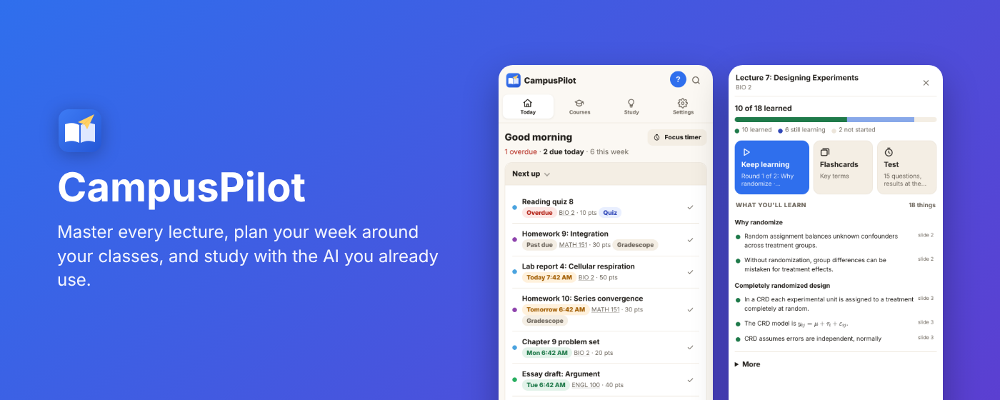

<h1 align="center">CampusPilot</h1>

Your Canvas courses, turned into a study coach. Free Chrome extension with free Gemini built in, or the AI you already use.

  <a href="https://chromewebstore.google.com/detail/fimfldjklciihkiipnncdgkbegkkcdim">Chrome Web Store</a> ·
  <a href="https://campuspilot.clabianco.fyi/">Website</a> ·
  <a href="https://campuspilot.clabianco.fyi/privacy.html">Privacy</a> ·
  <a href="https://campuspilot.clabianco.fyi/support.html">Support</a> ·
  <a href="https://campuspilot.clabianco.fyi/changelog.html">What's new</a>

## What it does

- **Your week at a glance:** every deadline across your courses, what changed since you last looked, and exam dates found in your syllabus and announcements.
- **Lecture mastery:** your AI reads each lecture once and lists everything to learn, slide by slide; CampusPilot checks nothing was skipped, then you learn it in short parts with questions it grades itself (multiple choice with reasons, matching, ordering, calculations with fresh numbers, step-by-step problems, explain-in-your-own-words). The lecture and slide on every question open the lecture right there.
- **Study now:** one button for ten minutes of the right practice: due reviews first, then the next round of what you're learning. With Gemini, answer keys are checked against your slides, typed explanations are read for you, and questions fit the subject.
- **Mixed test:** pick lectures and how much each counts; one test from the questions you already have, missed ones first.
- **My week:** class times your AI finds in your syllabi (with your own section), the study time you mark, deadlines and exams on one weekly calendar. Shown on Canvas's own calendar too, downloadable as a calendar file, or kept in Google Calendar.
- **Study plan:** pick what you're studying for; your AI sizes each assignment once from its files and sets priorities; CampusPilot fits the work into your study time and moves anything you miss.
- **Free AI, set up in a minute:** "Sign in with Google" makes your own free Gemini key (CampusPilot shows exactly what it does first), and every answer comes straight back into CampusPilot. Or use the AI you already use: CampusPilot fills in the request, you press Send, and it picks up the answer.
- **One list for your AI:** every request waiting for your AI in one place, run one after another.
- **JupyterHub notebooks as lectures:** lecture notebooks from each course's hub get the same checklists and questions, with their outputs, plots and data; homework notebooks help size the study plan.
- **Focus timer, search across everything, grade calculator, tidy file downloads,** and learning from graded Gradescope work.

No CampusPilot account and no server: your data stays in your browser (plus optional sync, which also backs up your lecture files, to a private app folder in your own Google Drive), and AI requests go straight to the AI you chose. See the [privacy policy](docs/privacy.html).

## Install

- **Most people:** install from the [Chrome Web Store](https://chromewebstore.google.com/detail/fimfldjklciihkiipnncdgkbegkkcdim).
- **From source:** download this repository, open `chrome://extensions`, turn on Developer mode, click **Load unpacked** and pick the folder. Google sign-in only works in the store version (see [SETUP-GOOGLE.md](SETUP-GOOGLE.md)).

## Project layout

| Folder | What's in it |
| --- | --- |
| `background.js`, `lib/` | The service worker: Canvas, Gradescope and video readers, mastery, schedule and plan logic, search, sync, focus timer |
| `sidepanel/` | The side panel (Home, Courses, Study, Settings) |
| `week/` | My week, the weekly calendar page |
| `content/` | Small scripts on Canvas pages (themes, to-do lists, video speed, the calendar overlay) |
| `viewer/` | The slide viewer the lecture links open |
| `grades/` | The grade calculator |
| `offscreen/` | PDF reading and zip building |
| `vendor/` | Bundled libraries: [pdf.js](https://github.com/mozilla/pdf.js) and [KaTeX](https://github.com/KaTeX/KaTeX), both with their licenses |
| `docs/` | The website, privacy policy, support page and changelog page |
| `worker/`, `wrangler.jsonc` | The website's host on Cloudflare, and the small server that receives "Report a problem" and tool suggestions from the extension |
| `tools/` | `build-changelog.py`, which rebuilds `docs/changelog.html` from `CHANGELOG.md` |

Version history is in [CHANGELOG.md](CHANGELOG.md), also on the website at [What's new](https://campuspilot.clabianco.fyi/changelog.html). After editing it, run `python3 tools/build-changelog.py` to rebuild that page.

CampusPilot is an independent project and isn't affiliated with Instructure, Gradescope, Panopto or any AI provider.
